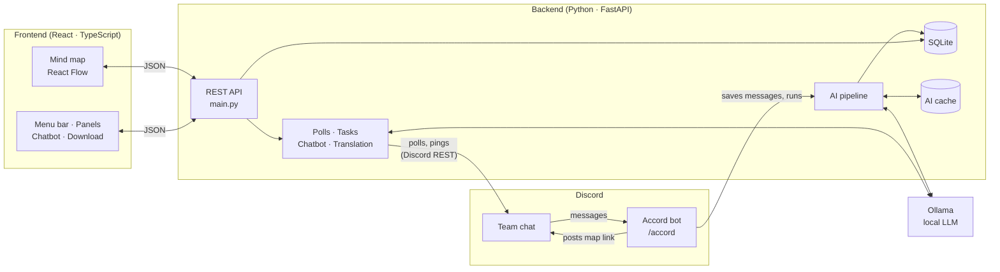

<p align="center">
  
</p>

<h1 align="center">Accord[Winner-MACS-HACKS'26]</h1>

<p align="center">
  <b>From the noise of discussions to the clarity of decisions.</b><br>
  Discord, reinvented as a living mind map of your team’s conversations.
</p>

<p align="center">
  MACS-HACKS 2026 · “Reinvent the Wheel” · Team SAMURAI
</p>

---

## The problem

Teams make real decisions in Discord, but they get buried. Five topics run at once, replies
are scattered, and anyone who joins late has to scroll through hundreds of messages to find out
what was actually decided.

## What Accord does

Type **`/accord`** in any channel. Accord reads the recent messages, splits them into separate
conversations, and turns them into a zoomable **mind map**:

- 🧭 **Conversations, not a wall of text.** Each topic gets its own box with its **activity**
  (Active, Dormant, Reopened), its **status** (Open, Debating, Decided) and its **type**
  (discussion, argument, off-topic).
- ✅ **Decisions you can trust.** A decision needs explicit agreement. When the team changes its
  mind, the old decision is shown crossed out as *Replaced*.
- ⚖️ **Arguments split into For and Against**, and questions linked to their answers.
- 🔗 **Every point links to its source messages**, and points the AI is unsure about are marked *Not sure*.

Then act on it without leaving the map:

| Feature | What it does |
|---|---|
| **Poll** | Publishes a native Discord poll about a topic. The winner becomes the official decision (*Decided by poll*). |
| **Actions** | Creates tasks linked to a decision or message. The bot pings the assignee in Discord. |
| **Ask Accord** | A chatbot that answers only from this channel, with numbered sources you can click. |
| **Translation** | Translates the whole page into 9 languages (including Arabic, right-to-left). Original messages are never changed. |
| **Download** | Saves the current view as a PNG, or a full PDF report. |
| **Mode** | Light and dark themes. Follows your computer until you pick one. |
| **List view** | A screen-reader-friendly version of the map. |

**Accessible by design:** full keyboard navigation, visible focus, screen-reader labels and live
announcements, WCAG AA contrast in both themes, and responsive layouts.

**Private and free:** the AI runs locally with [Ollama](https://ollama.com). No chat data leaves your machine.

---

## Architecture



**How a `/accord` run works**

1. **Save** new messages from the channel (edits and deletes are kept in sync).
2. **Split** them into conversations and give each a short name (AI).
3. **Extract** decisions, proposals, points for and against, and questions, each linked to its source messages (AI).
4. **Merge** near-duplicate points, then **link** questions to their answers.
5. **Review:** one more AI pass scores confidence and marks decisions that a later one replaced.
6. **Status and activity** are worked out with plain rules, no AI.

Every AI answer is **cached** against the exact messages it read: the same input gives the same
result instantly, and only edited conversations are re-analyzed. More detail is in
[`backend/AI_PIPELINE.md`](backend/AI_PIPELINE.md).

---

## Project structure

```
Accord/
├── backend/
│   ├── main.py                    # FastAPI app: routes + CORS
│   ├── app/
│   │   ├── api/
│   │   │   ├── channels.py        # /analyze and /view (the map’s data)
│   │   │   ├── topics.py
│   │   │   └── workspace.py       # server info, polls, tasks, chatbot, translation
│   │   ├── bot/
│   │   │   ├── discord_bot.py     # the /accord slash command
│   │   │   └── message_sync.py    # keeps edits and deletes in sync
│   │   ├── services/
│   │   │   ├── pipeline.py        # runs the steps above in order
│   │   │   ├── segmentation.py    # splits chat into conversations
│   │   │   ├── claim_extraction.py
│   │   │   ├── claim_review.py
│   │   │   ├── question_answer_linking.py
│   │   │   ├── topic_state.py     # status + activity rules
│   │   │   ├── ai.py              # Ollama calls + cache
│   │   │   ├── polls.py · tasks.py
│   │   │   ├── assistant.py       # chatbot + translation
│   │   │   └── discord_api.py     # posts polls and task pings
│   │   ├── models.py              # database tables
│   │   └── migrations.py          # adds new columns to old databases
│   └── requirements.txt
└── frontend/
    └── src/
        ├── App.tsx                # page layout
        ├── components/
        │   ├── MindMap.tsx        # the zoomable map
        │   ├── nodes.tsx          # conversation and point boxes
        │   ├── Header.tsx         # MindMap | Actions | Poll | Translation | Mode
        │   ├── PollPanel.tsx · ActionsPanel.tsx
        │   ├── ChatBot.tsx · DownloadMenu.tsx · ListView.tsx
        │   └── ui/                # accessible Dialog, Menu, Toasts…
        ├── state/
        │   ├── workspace.tsx      # shared app state
        │   └── i18n.tsx           # translation
        ├── layout.ts              # where boxes go on the map
        ├── download.ts            # PNG + PDF export
        └── index.css              # light and dark themes
```

## Tech stack

| | |
|---|---|
| **Frontend** | React 19, TypeScript, Vite, Tailwind CSS v4, React Flow (`@xyflow/react`), html-to-image |
| **Backend** | Python, FastAPI, SQLAlchemy, SQLite |
| **AI** | Ollama (local LLM, default `llama3.2:3b`) with structured JSON output |
| **Discord** | discord.py (slash command and events), Discord REST API (polls and messages) |

---

## Running it locally

**You need:** Python 3.11+, Node 20+, [Ollama](https://ollama.com), and a Discord bot with the
*Send Messages*, *Read Message History* and *Send Polls* permissions and the Message Content intent.

**1. Configure**

`backend/.env`
```
DISCORD_BOT_TOKEN=your-bot-token
OLLAMA_MODEL=llama3.2:3b
ACCORD_MAP_URL=http://localhost:5173
DORMANT_AFTER_SECONDS=120  
```

`frontend/.env`
```
VITE_API_URL=http://localhost:8000
```

**2. Start everything** (one terminal each)

```bash
# AI
ollama pull llama3.2:3b
ollama serve

# Backend
cd backend
python -m venv .venv && source .venv/bin/activate
pip install -r requirements.txt
uvicorn main:app --reload --port 8000

# Bot
cd backend && source .venv/bin/activate
python -m app.bot.discord_bot

# Frontend
cd frontend
npm install
npm run dev
```

**3. Use it:** run `/accord` in a Discord channel and open the map link the bot replies with.
API docs are at http://localhost:8000/docs.

---

## Team SAMURAI

**Pearl** (frontend) · **Aashana** (backend) · **Shriya**

Built in one weekend for MACS-HACKS 2026.
